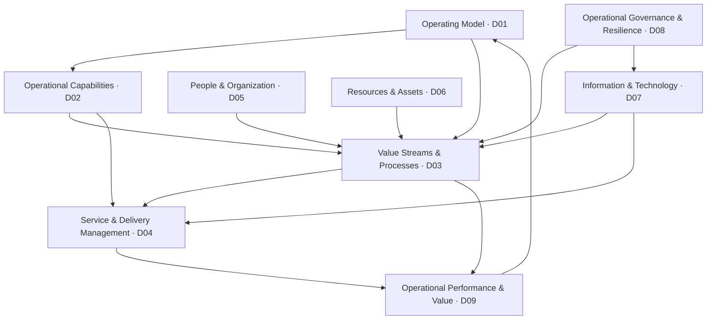

# Operations Maturity Model

**Assessing the enterprise operating engine: how the organization turns capabilities, people, processes, resources, information and technology into reliable outcomes — today, and ready for tomorrow.**

The Operations Maturity Model is the parent operational assessment for enterprise operations: how an enterprise runs its day-to-day operations, how work flows through value streams, how capabilities are orchestrated, how services are delivered, how people and resources are organized, how technology enables execution, how operations are governed and made resilient, and how operational activity realizes enterprise value — assessed through two complementary perspectives on every criterion: how effectively the enterprise operates **today** (Current Operational Realization) and how prepared it is to operate per its **future** strategic direction (Future Operational Readiness).

The model's scope is enterprise-wide. It extends beyond traditional IT operations and SRE without discarding those disciplines: information and technology operations remain a core dimension within the broader operating system.

---

## Find your starting point

| If you are a... | Start with |
|---|---|
| Executive, COO or operations sponsor | [What the model assesses](#what-the-model-assesses) and [Assessment results and priorities](#assessment-results-and-priorities) |
| Operations or value-stream leader | [The nine assessment dimensions](#the-nine-assessment-dimensions) and [How to run an assessment](#how-to-run-an-assessment) |
| Enterprise architect or operating-model designer | [Operating model](#the-nine-assessment-dimensions) and [Two assessment perspectives](#two-assessment-perspectives-one-criterion-identity) |
| Service, process or workforce leader | [Service & delivery management](#the-nine-assessment-dimensions) and [People & organization](#the-nine-assessment-dimensions) |
| Technology, platform or infrastructure operations leader | [Information & technology](#the-nine-assessment-dimensions) and [Boundaries with related assessment models](#boundaries-with-related-assessment-models) |
| Transformation or continuous-improvement leader | [Assessment results and priorities](#assessment-results-and-priorities) (the transformation gap is the actionable view) |
| Assessor or model contributor | [Assessment instrument and evidence](#assessment-instrument-and-evidence) and [Repository contents](#repository-contents) |

## What the model assesses

Enterprise operations are the system through which strategy is translated into daily activity and outcomes. They are not limited to the operation of technology infrastructure, nor are they simply a collection of processes or teams. The authoritative domain definition, boundaries and assessment method are in [`docs/domain/enterprise-operations.md`](docs/domain/enterprise-operations.md).

The model assesses nine connected concerns:

- **Operating model** — how the enterprise structures, organizes and coordinates operations, including decision rights and the gap between the designed and the realized operating model.
- **Operational capabilities** — what the enterprise must be able to do: architecture, ownership, availability, orchestration and the gaps that drive investment.
- **Value streams & processes** — how work is structured, coordinated and executed to produce outcomes, and how processes improve.
- **Service & delivery management** — how services and products are fulfilled and delivered: portfolio, delivery, quality, service levels and continuity.
- **People & organization** — how workforce, roles, skills, collaboration and ways of working sustain execution.
- **Resources & assets** — how financial, physical and human resources and assets are allocated, maintained and efficiently used.
- **Information & technology** — how information, data, applications, platforms and infrastructure enable and support execution.
- **Operational governance & resilience** — how operations are directed, controlled, assured and sustained under disruption.
- **Operational performance & value** — how performance is measured and how operations realize enterprise value, with efficiency/effectiveness readable separately from value realization.

The dimensions are interdependent — an enterprise may have well-defined processes but insufficient capabilities, capable people but fragmented information systems, sophisticated technology but ineffective governance. The assessment therefore examines both individual dimensions and their collective effectiveness.

## The nine assessment dimensions

The 3.0 enterprise model comprises **nine dimensions, 44 subdimensions and 132 criteria**. Dimension weights express their contribution to the Operations Index.

| ID | Dimension | Weight | Subdimensions | Criteria | Assessment focus |
|---|---|---:|---:|---:|---|
| **D01** | Operating Model | 12% | 5 | 15 | Operating model definition, structure & responsibilities, decision rights, alignment, evolution & realization |
| **D02** | Operational Capabilities | 12% | 5 | 15 | Capability architecture, ownership, availability & capacity, orchestration, dependencies/gaps/investment |
| **D03** | Value Streams & Processes | 12% | 5 | 15 | Value stream management, process architecture, execution consistency, workflow coordination & demand, improvement |
| **D04** | Service & Delivery Management | 11% | 5 | 15 | Service portfolio & catalogue, delivery management, quality & experience, service levels, delivery reliability |
| **D05** | People & Organization | 10% | 5 | 15 | Workforce planning, roles & responsibilities, skills, collaboration & culture, knowledge & ways of working |
| **D06** | Resources & Assets | 9% | 5 | 15 | Resource planning & allocation, asset lifecycle, capacity & utilization, suppliers & partners, efficiency & sustainability |
| **D07** | Information & Technology | 12% | 5 | 15 | Operational information & observability, data availability & quality, application/platform operations, infrastructure reliability, technology integration & enablement |
| **D08** | Operational Governance & Resilience | 11% | 5 | 15 | Policies & standards, risk & compliance, controls & assurance, business continuity, incident & problem management |
| **D09** | Operational Performance & Value | 11% | 4 | 12 | Performance management, efficiency & effectiveness, enterprise value realization, performance intelligence |
| | **Total** | **100%** | **44** | **132** | |

The complete criterion statements — each with its intent, current-state and future-state expectations, evidence requirements and measurement indicators — are in the [enterprise operations criteria register](maturity/model/operations.yaml) and the [dual-perspective questionnaire](maturity/assessment-questionnaire.yaml).

## How the dimensions work together

The dimensions are complementary views of one operating system, not independent organizational silos.

- **D01** examines whether the structural arrangement through which the enterprise executes is explicit, aligned and actually realized.
- **D02** examines whether the organization can bring the right capabilities together — and keep them available — to deliver that work.
- **D03** examines the flow and control of daily work through value streams and processes.
- **D04** examines the services through which commitments are made and fulfilled.
- **D05** and **D06** examine the people and resources that sustain execution.
- **D07** examines the information and technology that enable, support and assure operations.
- **D08** examines the governance and resilience that keep execution inside acceptable risk parameters.
- **D09** examines whether all of it converts into measured performance and realized enterprise value — and feeds the loop back to the operating model.

## Two assessment perspectives, one criterion identity

Every criterion carries two expectations and is scored twice on the same scale, weights and score mapping:

| Perspective | Question | Field | Aggregates to |
|---|---|---|---|
| **Current Operational Realization** | How effectively does the enterprise operate today? | `current_expectation` | **Operations Index** (0–100) → band → level |
| **Future Operational Readiness** | How prepared is the enterprise to operate per its future strategic direction? | `future_expectation` | **Readiness Index** (0–100) |

The **Transformation Gap** — readiness minus maturity, overall and per dimension — is reported separately. Negative values are readiness deficits: the enterprise operates today better than it is prepared to operate tomorrow. The two perspectives are never collapsed into a single score; maturity, readiness and performance are related but different measures (see the [domain definition](docs/domain/enterprise-operations.md)).

## Assessment instrument and evidence

The model provides a dual-perspective questionnaire with one entry for each of the 132 criteria (a current and a future question per criterion). Assessment records preserve criterion-level levels, assessment status, scores and evidence references per perspective, and the evidence schema defines the information required to make results traceable and repeatable.

Evidence confidence is represented through four categories and corresponding scoring multipliers:

| Evidence confidence | Multiplier | Interpretation |
|---|---:|---|
| Observed | 1.00 | Capability or practice directly observed |
| Evidenced | 0.85 | Supported by documented or recorded evidence |
| Self-reported | 0.60 | Reported by the assessed organization without equivalent independent substantiation |
| Unverified | 0.30 | Not yet verified; requires follow-up evidence |

Evidence should be linked to the relevant criterion and record its artifact reference, collection date, collector and confidence classification. The assessment record also captures the model version, assessment date, assessor, per-perspective criterion scores (`level_id`, `assessment_status`, `score`, `evidence_confidence`) and derived results.

See the [assessment questionnaire](maturity/assessment-questionnaire.yaml), [evidence and assessment schema](maturity/evidence/schema.yaml) and [evaluation method](maturity/evaluation.yaml).

## Maturity progression and scoring

The model uses five assessed capability levels, identified **L-1 through L-5**, and a separate **L-0 Not Assessed** state. L-0 is not a maturity level: it records that a criterion has not been assessed and must never be interpreted as L-1 Emergent.

| Identifier | Capability level | Canonical score range | Ops stage | Interpretation |
|---|---|---:|---|---|
| L-0 | Not Assessed | Not a maturity band | unassessed | No assessment evidence has been examined; recorded distinctly, contributes zero and carries unverified confidence |
| L-1 | Emergent | 0–20 | Absent | Operations is reactive and person-dependent |
| L-2 | Structured | (20, 45] | Initial | Core practices are documented and becoming consistent |
| L-3 | Systematic | (45, 70] | Defined & Managed | Operations is consistently executed, measured, governed and controlled |
| L-4 | Adaptive | (70, 88] | Integrated | Capabilities coordinate enterprise-wide, optimized using performance intelligence |
| L-5 | Self-Optimising | (88, 100] | Adaptive | Operations continuously learn, anticipate and adapt; autonomous execution may contribute but is **not** required |

The five assessed level identifiers align with the canonical v2 level-identification convention (upstream change request [dea-metamodel #214](https://github.com/technehub-labs/dea-metamodel/issues/214); adoption pending ratification). The *Ops stage* column is the model's additive progression vocabulary (`ops_stage_by_ordinal` on the register) — metadata, never a second level ladder.

At 3.0.0 the level **definitions and characteristics evolve from the legacy technology-operations wording to enterprise-operations semantics** (CR-OM-01 §5a — a deliberate major-boundary decision superseding CR-AM-17's preserve-verbatim choice; the identifier migration, names, score bands and score preservation are unchanged). The [domain definition](docs/domain/enterprise-operations.md) carries the full progression rationale.

Historical records using the former model-local identifiers are translated through the explicit [scale migration map](migrations/scale-v1-to-v2-map.yaml): legacy L0–L4 map respectively to L-1–L-5. Legacy L0 is **not** the new L-0 Not Assessed state.

The evaluation method calculates results in this sequence:

1. **Criterion score:** select an assessed level L-1–L-5 and map its ordinal to 0, 25, 50, 75 or 100. L-0 is reserved for an unassessed criterion and contributes zero; it is not an assessed capability level.
2. **Evidence adjustment:** apply the evidence-confidence multiplier to assessed criterion scores.
3. **Dual perspectives:** answer each criterion twice — current realization and future readiness — on the same scale and mapping.
4. **Subdimension score:** the mean of its criteria, with an unassessed criterion contributing zero rather than being silently omitted (per perspective).
5. **Dimension score:** the mean of its subdimensions (per perspective).
6. **Operations Index and Readiness Index:** each the weighted sum of the nine dimension scores using the declared dimension weights — current scores yield the Operations Index, future scores the Readiness Index; they are never averaged together.
7. **Transformation Gap:** Readiness Index minus Operations Index, overall and per dimension.
8. **Maturity band and level:** resolve the unrounded Operations Index against the canonical v2 score bands. The resolved capability level is L-1–L-5; score-based resolution never returns L-0.
9. **Effort-adjusted value (EAV):** calculate the marginal score contribution within each band and divide each contribution by that band's effort multiplier:

   `EAV(S) = Σ(Pk(S) / Mk)`

   where `Pk(S)` is the number of score points contributed by aggregate score `S` within band `k`, and `Mk` is its multiplier.

| Marginal score interval | Effort multiplier |
|---|---:|
| [0, 20] | 1.0 |
| (20, 45] | 1.5 |
| (45, 70] | 2.5 |
| (70, 88] | 4.0 |
| (88, 100] | 6.0 |

EAV accumulates progressively across the bands. It does **not** multiply the entire Operations Index by the multiplier of the resolved band. Its theoretical maximum is 53.1666666667; reported values are rounded to two decimal places. EAV is a supplementary effort-weighted index, distinct from the 0–100 Operations Index, and does not determine maturity-level resolution.

The worked [Operations scoring example](examples/operations-2026.yaml) and [baseline-versus-target campaign](campaigns/baseline-vs-target-2026.yaml) demonstrate the calculations, including the dual perspectives and the transformation gap. The normative rules are maintained in [maturity/evaluation.yaml](maturity/evaluation.yaml) and the level definitions in [maturity/scale.yaml](maturity/scale.yaml).

## Assessment results and priorities

A useful assessment is more than a single index. The model deliberately produces **four distinct views** (never averaged into one number):

1. **Current operational maturity** — the Operations Index, its band and resolved level.
2. **Current operational performance and value** — the D09 subdimension scores, with *operational efficiency & effectiveness* and *enterprise value realization* readable separately: an enterprise can be efficient yet strategically misaligned, and the model exposes both conditions.
3. **Future operational readiness** — the Readiness Index over the same criteria.
4. **Operational transformation gap** — readiness minus maturity, overall and per dimension; the primary input to transformation planning.

Use the results to:

- Compare the nine dimension scores and identify the strongest and weakest parts of the operating model.
- Inspect criterion-level evidence rather than relying on a headline score alone.
- Identify whether weaknesses originate in the operating model, capability orchestration, flow, services, people, resources, technology, governance or value conversion.
- Read the transformation gap per dimension to sequence target-operating-model work *before* performance pressure exposes the deficit.
- Translate gaps into operational blueprint changes, capability improvements, process and service interventions, workforce changes or technology initiatives.
- Establish a baseline and target assessment, then track criterion-level and dimension-level progress over time.

The repository includes a [baseline-versus-target campaign example](campaigns/baseline-vs-target-2026.yaml). It is illustrative and does not represent an actual organization. The [blueprint deduction rules](maturity/blueprint-deduction.yaml) map selected assessment patterns — including a readiness-deficit rule — to operational blueprint recommendations; treat these as advisory until that rule set is formally adopted.

## Boundaries with related assessment models

The Operations model is the **parent operational assessment**: it has broad enterprise coverage but does not absorb the specialist concerns of neighboring models. It assesses whether specialized execution (notably autonomous execution) is governed, integrated and aligned with enterprise requirements; specialist models assess the depth of the specialist mechanisms themselves. Specialized scores are **never averaged** into the Operations Index. Its declared model touchpoints establish where evidence can be reused and which model owns the deeper assessment.

| Concern | Primary model responsibility | Relationship to Operations |
|---|---|---|
| Human-led and assisted enterprise operations | **Operations Maturity Model** | Owns the operating model, capabilities, value streams, services, people, resources, governance and value conversion |
| Technology and infrastructure operations | **Operations Maturity Model**, D07 | Assesses operational use and effectiveness of technology, reliability, observability and automation |
| Closed-loop, intent-driven autonomous operations | [Autonomous Operations Maturity Model](https://github.com/Assessment-Models/maturity-model-autonomous-operations) | Operations evidence can inform the specialist model; the specialist model assesses OODA ownership, autonomous decision-making and agent governance |
| Customer-facing delivery flow and delivery outcomes | [Services Delivery Maturity Model](https://github.com/Assessment-Models/maturity-model-services-delivery) | Operations assesses internal flow health and delivery operations (D03/D04); the specialist model assesses delivery outcomes and customer-visible performance |
| Technology capability and technology practices | [Technology Maturity Model](https://github.com/Assessment-Models/maturity-model-technology) | Operations assesses how technology is operated; the specialist model assesses technology capability and practice |
| Digital transformation and enterprise change | [Digital Transformation Maturity Model](https://github.com/Assessment-Models/maturity-model-digital-transformation) (+ operationalized) | Operations provides evidence about the operating system and its execution |
| Architecture modernization practice | [Architecture Modernization Maturity Model](https://github.com/Assessment-Models/maturity-model-modernization) | Uses a shared operations-modernization component; each model retains its own assessment purpose and scoring |

The guiding boundary is **one criterion, one owning model**. Related models may reuse evidence through declared touchpoints, but this does not make their criteria, scoring or maturity results interchangeable. See [touchpoints.yaml](touchpoints.yaml) for the model's declared relationships (v0.3.0 — `ours` mappings re-pointed to v3 criterion ids; peer mirrors pending the same re-map).

## How to run an assessment

1. **Set the assessment context.** Identify the enterprise or business unit, operational scope, assessment date and accountable sponsor.
2. **Establish the baseline.** Identify relevant value streams, services, capabilities, teams, resources and technology operations in scope.
3. **Gather evidence.** Collect operational records, service and process artifacts, capability maps, workforce and resource information, technology telemetry, governance records and strategy/operating-model evidence.
4. **Complete the questionnaire.** Assess each applicable criterion **twice** — current realization and future readiness — recording levels, scores, evidence and confidence classification per perspective.
5. **Calculate the profile.** Apply the evaluation method: Operations Index, Readiness Index, transformation gap, band/level resolution and marginal EAV.
6. **Interpret the results.** Use the four views; identify cross-dimensional constraints and readiness deficits; prioritize improvements against operational outcomes.
7. **Set targets and reassess.** Record the target state and assessment period, then compare the next assessment with the baseline.

The [assessment questionnaire](maturity/assessment-questionnaire.yaml) is the primary instrument. The [worked campaign](campaigns/baseline-vs-target-2026.yaml) demonstrates how baseline, target and delta records are represented.

## Repository contents

| Resource | Purpose |
|---|---|
| [model.yaml](model.yaml) | Model identity, contract handshake, dependencies and component declarations |
| [maturity/model/operations.yaml](maturity/model/operations.yaml) | Enterprise Operations criteria register (v3): nine dimensions, 44 subdimensions, 132 criteria with dual perspectives |
| [maturity/assessment-questionnaire.yaml](maturity/assessment-questionnaire.yaml) | Dual-perspective criterion questions and evidence prompts (generated from the register) |
| [maturity/scale.yaml](maturity/scale.yaml) | Model-owned scale: L-0 sentinel + five capability levels with enterprise-operations semantics |
| [maturity/evaluation.yaml](maturity/evaluation.yaml) | Scoring, evidence confidence, dual perspectives, aggregation, band resolution and marginal EAV |
| [maturity/evidence/schema.yaml](maturity/evidence/schema.yaml) | Evidence item, per-perspective criterion scores, assessment and campaign record structures |
| [maturity/blueprint-deduction.yaml](maturity/blueprint-deduction.yaml) | Draft rule map from assessment patterns to operational blueprint recommendations |
| [campaigns/](campaigns/) | Baseline-to-target assessment campaign examples |
| [examples/](examples/) | Worked scoring example |
| [migrations/](migrations/) | Criterion and scale compatibility maps for v1/v2/v3 transitions |
| [docs/domain/enterprise-operations.md](docs/domain/enterprise-operations.md) | Authoritative domain definition, boundaries and assessment method |
| [docs/cr/](docs/cr/) | Change programme: CR-OM-01 (v3), CR-AM-17 (scale migration), CR-AM-19 (marginal EAV), CR-AM-13 (historical) |
| [touchpoints.yaml](touchpoints.yaml) | Declared relationships and evidence mappings to sibling assessment models |
| [assessment-manifest.json](assessment-manifest.json) / [standard.yaml](standard.yaml) | Front-end discovery manifest and repository-standard declaration |
| [CHANGELOG.md](CHANGELOG.md) | Versioned model changes and release history |
| [CONTRIBUTING.md](CONTRIBUTING.md) | Change control and contribution rules |

## Governance and contribution

The Operations Maturity Model is maintained by the [Assessment-Models organisation](https://github.com/Assessment-Models). Changes to model identity, dimensions, subdimensions, criterion definitions, scoring, evidence semantics, weights, maturity definitions or model relationships must follow the repository's change-control process.

Contributors should preserve permanent criterion identifiers, maintain compatibility and migration records when model changes affect historical assessments, and update the questionnaire, evaluation method, evidence schema and examples alongside any adopted model change. Changes to model relationships must keep the relevant touchpoint declarations and peer mappings synchronized.

See [CONTRIBUTING.md](CONTRIBUTING.md) and [CHANGELOG.md](CHANGELOG.md).

## Status

**Repository maturity-model release: 3.0.0** · **License:** MIT

The 3.0.0 release (CR-OM-01) evolves the model into the parent operational assessment for enterprise operations — nine dimensions with dual Current-Realization / Future-Readiness perspectives, the transformation gap as a first-class result, and enterprise-operations level semantics — on top of the approved CR-AM-17 scale identity migration and CR-AM-19 marginal-band EAV. Level renumbering adoption remains pending [dea-metamodel #214](https://github.com/technehub-labs/dea-metamodel/issues/214) ratification; v2 records convert via the published migration maps.

## License

MIT. See [LICENSE](LICENSE).
