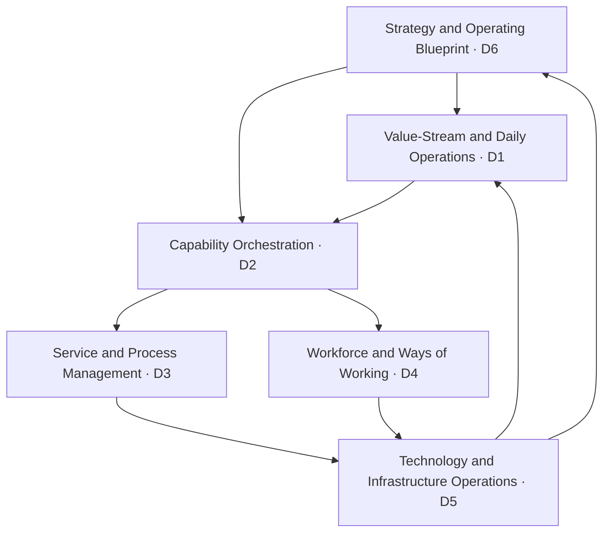

# Operations Maturity Model

**Assessing the enterprise operating engine: how the organization turns capabilities, people, processes and technology into reliable outcomes.**

The Operations Maturity Model assesses how an enterprise runs its day-to-day operations: how work flows through value streams, how organizational capabilities are orchestrated, how services and processes are managed, how people work together, how technology and infrastructure are operated, and how operations remain aligned to strategic intent.

The model's 2.0 scope is enterprise-wide. It extends beyond traditional IT operations and SRE without discarding those disciplines: technology and infrastructure operations remain a core dimension within the broader operating model.

---

## Find your starting point

| If you are a... | Start with |
|---|---|
| Executive, COO or operations sponsor | [What the model assesses](#what-the-model-assesses) and [Interpreting results](#assessment-results-and-priorities) |
| Operations or value-stream leader | [Six assessment dimensions](#the-six-assessment-dimensions) and [How to assess](#how-to-run-an-assessment) |
| Enterprise architect or operating-model designer | [Strategy alignment and operating blueprint](#the-six-assessment-dimensions) |
| Service, process or workforce leader | [Service and process management](#the-six-assessment-dimensions) and [Workforce and ways of working](#the-six-assessment-dimensions) |
| SRE, platform, infrastructure or technology operations leader | [Technology and infrastructure operations](#the-six-assessment-dimensions) |
| Transformation or continuous-improvement leader | [Using results to improve operations](#assessment-results-and-priorities) |
| Assessor or model contributor | [Assessment instrument](#assessment-instrument-and-evidence) and [Repository contents](#repository-contents) |

## What the model assesses

Enterprise operations are the system through which strategy is translated into daily activity and outcomes. They are not limited to the operation of technology infrastructure, nor are they simply a collection of processes or teams.

The model assesses six connected concerns:

- How value streams, demand, work-in-progress and daily commitments are made visible and managed.
- How organizational capabilities are identified, coordinated and leveraged to deliver outcomes.
- How operational processes and services are standardized, owned, measured and improved.
- How workforce roles, team structures, skills, collaboration and ways of working sustain operational performance.
- How technology and infrastructure are observed, secured, supported, changed and kept reliable.
- How day-to-day operations are connected to strategic objectives and the enterprise operating blueprint.

The model is designed to help leaders understand the operating system as a whole, identify where operational performance is constrained, and determine which improvements will strengthen the organization's ability to deliver outcomes.

## The six assessment dimensions

The 2.0 enterprise model comprises **six dimensions, 19 subdimensions and 51 criteria**. Dimension weights express their contribution to the Operations Index.

| ID | Dimension | Weight | Subdimensions | Criteria | Assessment focus |
|---|---|---:|---:|---:|---|
| **D1** | Value-Stream & Daily Operations | 20% | 3 | 8 | Flow visibility, operating cadence, demand and work management |
| **D2** | Capability Orchestration | 18% | 3 | 8 | Capability inventory, capability-to-outcome leverage, cross-functional coordination |
| **D3** | Service & Process Management | 18% | 3 | 8 | Process standardization and ownership, service management, continual improvement |
| **D4** | Workforce & Ways of Working | 14% | 3 | 7 | Roles, team structures, skills, workforce sustainability and collaboration |
| **D5** | Technology & Infrastructure Operations | 20% | 4 | 12 | Observability, incident and problem management, deployment automation, reliability and SRE |
| **D6** | Strategy Alignment & Operating Blueprint | 10% | 3 | 8 | Strategy-to-operations alignment, operating-model governance and digital-nexus adoption |
| | **Total** | **100%** | **19** | **51** | |

The complete criterion statements, assessment prompts and evidence expectations are in the [enterprise operations criteria register](maturity/model/operations-v2-draft.yaml) and [assessment questionnaire](maturity/assessment-questionnaire.yaml).

## How the dimensions work together

The dimensions are complementary views of one operating system, not independent organizational silos.

- **D1** examines the flow and control of daily work.
- **D2** examines whether the organization can bring the right capabilities together to deliver that work.
- **D3** examines the services and processes through which work is standardized and improved.
- **D4** examines the people, structures and practices that sustain execution.
- **D5** examines the technology and infrastructure that enable, support and assure operations.
- **D6** examines whether the operating system remains connected to strategic direction and the operating blueprint.

## Assessment instrument and evidence

The model provides a full assessment questionnaire with one entry for each of the 51 criteria. Assessment records preserve criterion-level scores and evidence references, and the evidence schema defines the information required to make results traceable and repeatable.

Evidence confidence is represented through four categories and corresponding scoring multipliers:

| Evidence confidence | Multiplier | Interpretation |
|---|---:|---|
| Observed | 1.00 | Capability or practice directly observed |
| Evidenced | 0.85 | Supported by documented or recorded evidence |
| Self-reported | 0.60 | Reported by the assessed organization without equivalent independent substantiation |
| Unverified | 0.30 | Not yet verified; requires follow-up evidence |

Evidence should be linked to the relevant criterion and record its artifact reference, collection date, collector and confidence classification. The assessment record also captures the model version, assessment date, assessor, scores and derived results.

See the [assessment questionnaire](maturity/assessment-questionnaire.yaml), [evidence and assessment schema](maturity/evidence/schema.yaml) and [evaluation method](maturity/evaluation.yaml).

## Maturity progression and scoring

The Operations Maturity Model uses five assessed capability levels, identified **L-1 through L-5**, and a separate **L-0 Not Assessed** state. L-0 is not a maturity level: it records that a criterion has not been assessed and must never be interpreted as L-1 Emergent.

| Identifier | Capability level | Canonical score range | Interpretation |
|---|---|---:|---|
| L-0 | Not Assessed | Not a maturity band | No assessment evidence has been examined; recorded distinctly, contributes zero and carries unverified confidence |
| L-1 | Emergent | 0–20 | Operations is reactive and person-dependent |
| L-2 | Structured | (20, 45] | Core practices are documented and becoming consistent |
| L-3 | Systematic | (45, 70] | Operations is governed, standardized and metrics-driven |
| L-4 | Adaptive | (70, 88] | Operations senses and responds using predictive insight and automation |
| L-5 | Self-Optimising | (88, 100] | Continuous improvement is embedded and increasingly autonomous |

The five assessed level identifiers align with the canonical v2 level-identification convention. The model retains its Operations-specific level names, definitions and evidence expectations. Historical records using the former model-local identifiers are translated through the explicit [scale migration map](migrations/scale-v1-to-v2-map.yaml): legacy L0–L4 map respectively to L-1–L-5. Legacy L0 is **not** the new L-0 Not Assessed state.

The evaluation method calculates results in this sequence:

1. **Criterion score:** select an assessed level L-1–L-5 and map its ordinal to 0, 25, 50, 75 or 100. L-0 is reserved for an unassessed criterion and contributes zero; it is not an assessed capability level.
2. **Evidence adjustment:** apply the existing evidence-confidence multiplier to assessed criterion scores.
3. **Subdimension score:** calculate the mean of its criteria, with an unassessed criterion contributing zero rather than being silently omitted.
4. **Dimension score:** calculate the mean of its subdimensions.
5. **Operations Index:** calculate the weighted sum of the six dimension scores using the declared dimension weights.
6. **Maturity band and level:** resolve the Operations Index against the canonical v2 score bands. The resolved capability level is L-1–L-5; score-based resolution never returns L-0.
7. **Effort-adjusted value (EAV):** calculate the marginal score contribution within each band and divide each contribution by that band's effort multiplier:

   `EAV(S) = Σ(Pk(S) / Mk)`

   where `Pk(S)` is the number of score points contributed by aggregate score `S` within band `k`, and `Mk` is its multiplier.

| Marginal score interval | Effort multiplier |
|---|---:|
| [0, 20] | 1.0 |
| (20, 45] | 1.5 |
| (45, 70] | 2.5 |
| (70, 88] | 4.0 |
| (88, 100] | 6.0 |

EAV accumulates progressively across the bands. It does **not** multiply the entire Operations Index by the multiplier of the resolved band. Its theoretical maximum is 53.1666666667; reported values are rounded to two decimal places. EAV is a supplementary effort-weighted index, distinct from the 0–100 Operations Index, and does not determine maturity-level resolution.

The worked [Operations scoring example](examples/operations-2026.yaml) and [baseline-versus-target campaign](campaigns/baseline-vs-target-2026.yaml) demonstrate the calculations. The normative rules are maintained in [maturity/evaluation.yaml](maturity/evaluation.yaml) and the level definitions in [maturity/scale.yaml](maturity/scale.yaml).

## Assessment results and priorities

A useful assessment is more than a single index. It should reveal where the operating model performs well, where it is constrained, and how improvement in one dimension affects the wider operating system.

Use the results to:

- Compare the six dimension scores and identify the strongest and weakest parts of the operating model.
- Inspect criterion-level evidence rather than relying on a headline score alone.
- Identify whether weaknesses originate in flow, capability orchestration, service/process management, workforce practices, technology operations or strategic alignment.
- Translate gaps into operational blueprint changes, capability improvements, process and service interventions, workforce changes or technology initiatives.
- Establish a baseline and target assessment, then track criterion-level and dimension-level progress over time.

The repository includes a [baseline-versus-target campaign example](campaigns/baseline-vs-target-2026.yaml). It is illustrative and does not represent an actual organization. The [blueprint deduction rules](maturity/blueprint-deduction.yaml) provide a draft mapping from selected assessment patterns to operational blueprint recommendations; treat these as advisory until that rule set is formally adopted.

## Boundaries with related assessment models

The Operations model has broad enterprise coverage, but it does not absorb the specialist concerns of every neighboring model. Its declared model touchpoints establish where evidence can be reused and which model owns the deeper assessment.

| Concern | Primary model responsibility | Relationship to Operations |
|---|---|---|
| Human-led and assisted enterprise operations | **Operations Maturity Model** | Owns value-stream operations, capability orchestration, services, processes, workforce and operating alignment |
| Technology and infrastructure operations | **Operations Maturity Model**, D5 | Assesses operational use and effectiveness of technology, reliability, observability and automation |
| Closed-loop, intent-driven autonomous operations | [Autonomous Operations Maturity Model](https://github.com/Assessment-Models/maturity-model-autonomous-operations) | Operations evidence can inform the specialist model; the specialist model assesses OODA ownership, autonomous decision-making and agent governance |
| Customer-facing delivery flow and delivery outcomes | [Services Delivery Maturity Model](https://github.com/Assessment-Models/maturity-model-services-delivery) | Operations assesses internal flow health; the specialist model assesses delivery outcomes and customer-visible performance |
| Technology capability and technology practices | [Technology Maturity Model](https://github.com/Assessment-Models/maturity-model-technology) | Operations assesses how technology is operated; the specialist model assesses technology capability and practice |
| Digital transformation and enterprise change | [Digital Transformation Maturity Model](https://github.com/Assessment-Models/maturity-model-digital-transformation) | Operations provides evidence about the operating system and its execution |
| Architecture modernization practice | [Architecture Modernization Maturity Model](https://github.com/Assessment-Models/maturity-model-modernization) | Uses a shared operations-modernization component; each model retains its own assessment purpose and scoring |

The guiding boundary is **one criterion, one owning model**. Related models may reuse evidence through declared touchpoints, but this does not make their criteria, scoring or maturity results interchangeable. See [touchpoints.yaml](touchpoints.yaml) for the model's declared relationships.

## How to run an assessment

1. **Set the assessment context.** Identify the enterprise or business unit, operational scope, assessment date and accountable sponsor.
2. **Establish the baseline.** Identify relevant value streams, services, capabilities, teams and technology operations in scope.
3. **Gather evidence.** Collect operational records, service and process artifacts, capability maps, workforce information, technology telemetry and strategy/operating-model evidence.
4. **Complete the questionnaire.** Assess each applicable criterion and record its score, evidence and confidence classification.
5. **Calculate the profile.** Apply the evaluation method and resolve the Operations Index and maturity band.
6. **Interpret the results.** Identify cross-dimensional constraints and prioritize improvements against operational outcomes.
7. **Set targets and reassess.** Record the target state and assessment period, then compare the next assessment with the baseline.

The [assessment questionnaire](maturity/assessment-questionnaire.yaml) is the primary instrument. The [worked campaign](campaigns/baseline-vs-target-2026.yaml) demonstrates how baseline, target and delta records are represented.

## Repository contents

| Resource | Purpose |
|---|---|
| [model.yaml](model.yaml) | Model identity, contract handshake, dependencies and component declarations |
| [maturity/model/operations-v2-draft.yaml](maturity/model/operations-v2-draft.yaml) | Enterprise Operations criteria register: six dimensions, 19 subdimensions and 51 criteria |
| [maturity/assessment-questionnaire.yaml](maturity/assessment-questionnaire.yaml) | Criterion-level assessment questions and evidence prompts |
| [maturity/scale.yaml](maturity/scale.yaml) | Five model-specific capability levels and their definitions |
| [maturity/evaluation.yaml](maturity/evaluation.yaml) | Scoring, evidence confidence, aggregation and band resolution |
| [maturity/evidence/schema.yaml](maturity/evidence/schema.yaml) | Evidence item, assessment record and campaign record structures |
| [maturity/blueprint-deduction.yaml](maturity/blueprint-deduction.yaml) | Draft rule map from assessment patterns to operational blueprint recommendations |
| [campaigns/](campaigns/) | Baseline-to-target assessment campaign examples |
| [migrations/](migrations/) | Criterion and scale compatibility maps for v1/v2 transitions |
| [touchpoints.yaml](touchpoints.yaml) | Declared relationships and evidence mappings to sibling assessment models |
| [CHANGELOG.md](CHANGELOG.md) | Versioned model changes and release history |
| [CONTRIBUTING.md](CONTRIBUTING.md) | Change control and contribution rules |

## Governance and contribution

The Operations Maturity Model is maintained by the [Assessment-Models organisation](https://github.com/Assessment-Models). Changes to model identity, dimensions, subdimensions, criterion definitions, scoring, evidence semantics, weights, maturity definitions or model relationships must follow the repository's change-control process.

Contributors should preserve permanent criterion identifiers, maintain compatibility and migration records when model changes affect historical assessments, and update the questionnaire, evaluation method, evidence schema and examples alongside any adopted model change. Changes to model relationships must keep the relevant touchpoint declarations and peer mappings synchronized.

See [CONTRIBUTING.md](CONTRIBUTING.md) and [CHANGELOG.md](CHANGELOG.md).

## Status

**Repository maturity-model release: 2.1.1** · **License:** MIT

The 2.1.1 release preserves the enterprise-wide scope introduced in 2.0.0 while aligning scale identifiers and EAV calculation with canonical conventions. Its six-dimension criteria register, questionnaire, evaluation method and evidence schema define the current assessment instrument.

## License

MIT. See [LICENSE](LICENSE).
